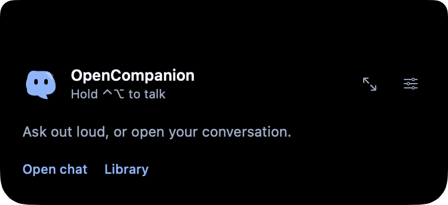
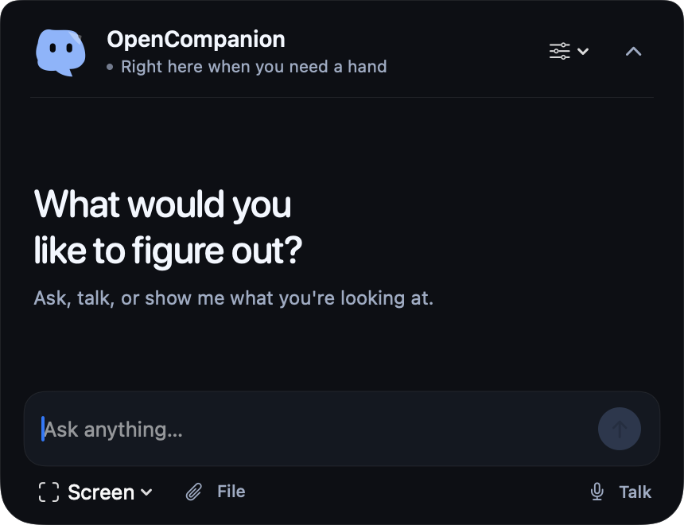

# OpenCompanion

An independent, open-source **notch companion for macOS**. Idle blends into the physical notch. Hover reveals a compact peek; open the conversation when you need it. Hold **Control + Option** to talk, then release to send and hear the answer.

**Active engineering alpha. The complete research specification is not yet fully implemented or acceptance-tested.** See [feature status](docs/FEATURE-STATUS.md) for the exact boundary.





## Try it

Apple Silicon; macOS14.2+; Xcode with Swift6. Current local verification uses macOS26.6.2. Older OS releases and Intel have not been exercised.

```sh
swift test
scripts/build-app.sh
scripts/install.sh
```

Open **OpenCompanion** from `/Applications/OpenCompanion.app`. Every update replaces that same app. Quit OpenCompanion before installing; the installer preserves your library and settings, verifies the new bundle, and moves verified older copies to Trash. Build copies stay in temporary, unindexed staging and are removed after installation. `dist/OpenCompanion-latest.zip` is the latest distributable archive.

Hover over the camera notch for a quick peek; move away to tuck it without losing your draft. Click **Open chat** or press **⌘⇧Space** for the full conversation. Hold **Control + Option**, wait for Listening, speak, and release either key to submit. The reply is spoken for that turn. **Escape** stops output. A notchless display gets a compact capsule below its menu bar.

Global voice observation needs macOS Input Monitoring or Accessibility access. Voice input also needs Microphone and Speech Recognition permission. Settings reports the installed monitor status and provides repair controls. Ordinary voice conversation does not capture the desktop. Requested screen guidance uses a fresh frame; other selected context follows its explicit scope.

If the shortcut is unavailable, choose **Set up voice** in the peek, then **Allow global voice shortcut…** in Settings. Enable the installed OpenCompanion in macOS Input Monitoring and quit/reopen it. Allow the first Microphone/Speech prompts, release the keys to interact with the prompt, then start a fresh hold.

Generated explanations appear on a transparent, click-through native canvas while conversation stays in the notch. The companion cursor visits narrated parts with its caption close beside it. Hold Option over a visible 3D part and drag to orbit; release to restore click-through. Open Notebook deliberately for editing, saving and export. [Scene pointing and verified limits](docs/SCENE-CURSOR-POINTING.md).

Settings includes configurable global shortcuts and an optional display-capture shortcut. Registration conflicts are reported; the last working shortcut stays available for that session.

### ChatGPT subscription mode

Install the official Codex CLI and sign in with `codex login`. In Settings, select **ChatGPT via Codex**, choose its executable path, and run **Test live connection**. A blank model uses the catalog default for conversation; new visual explanations and the Terra guidance preference select the newest eligible visible Terra model. Discovery follows a bounded paginated catalog, and only a completed request verifies access. OpenCompanion uses the documented stdio app-server; it does not read or copy your login tokens. Teaching requests disable external tool capabilities and run in an ephemeral read-only thread. Model usage remains subject to your plan and limits.

For 6.1 Terra, use Codex CLI 0.159.0 or later; the supported `codex update` command updates compatible standalone installations. Catalog availability depends on the CLI and account. See the [official model requirements](https://learn.chatgpt.com/docs/models) and the [runtime/discovery evidence](docs/TERRA-RUNTIME-UPGRADE.md).

Real completed subscription requests have produced two unrelated12-node diagrams and a retained-ID follow-up edit through the native app adapter. This establishes the tested path; it does not establish latency targets, all models, or production readiness.

### API key / selfhost mode

Configure an HTTPS OpenAI-compatible base URL, exact model ID and key in Settings. Keys stay in macOS Keychain. Cloud inference can incur separate costs. [Selfhost setup](docs/SELF-HOST.md) includes an authenticated open relay with cancellation and streaming.

## Included

- Native notch conversation panel, local character motion, text and Apple speech input/output.
- Deliberately selected display/window/region context with bounded AX/OCR and spatial drawing.
- Validated retained diagrams, editable notes, local animation controls, original motor/lever/circuit examples.
- Native 3D box/sphere/cylinder stages using SceneKit’s Metal backend; general physics is not claimed.
- Ordered explanation scenes, speech-driven cursor captions and native surface-grounded pointing.
- SQLite library, history/search, explicit memory, scoped text/PDF files with hashes and citations.
- App-running durable jobs/routines, cancellation, leases and unknown-outcome recovery.
- Actual MCP HTTP/SSE discovery/calls with account token isolation.
- Original browser extension/native host, document-scoped refs and fresh action receipts.

Some components are tested in isolation and still need complete installed acceptance. See [feature status](docs/FEATURE-STATUS.md), [architecture](docs/ARCHITECTURE.md), [privacy](docs/PRIVACY.md), [browser setup](docs/BROWSER.md), and [contributing](CONTRIBUTING.md).

## Validation

```sh
swift test
python3 -m unittest discover -s scripts/tests -p 'test_*.py'
python3 -m unittest discover -s NativeBrowserHost -p 'test_*.py'
python3 -m unittest discover -s Server -p 'test_*.py'
node --test BrowserExtension/test_protocol.mjs BrowserExtension/test_service.mjs
```

Opt-in live subscription checks consume your signed-in plan:

```sh
OPENCOMPANION_LIVE_CODEX_TEST=1 swift test --filter CodexProviderIntegrationTests
```

Default builds are ad-hoc signed. For local updates that retain a consistent code identity, reuse an existing certificate with the ignored [local signing configuration](docs/LOCAL-SIGNING.md). Developer ID signing, notarization, signed updates, physical multi-display/voice acceptance, installed browser pairing and broad held-out task benchmarks remain release gates. No exact HeyClicky visual or performance parity is claimed.

MIT. Original code/artwork; system frameworks and SQLite. See [notices](THIRD-PARTY-NOTICES.md).
